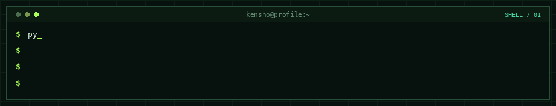
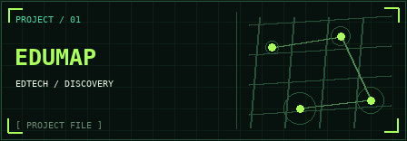
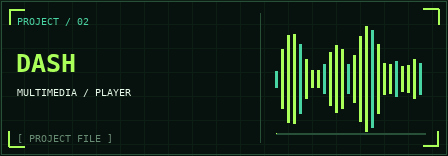
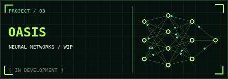
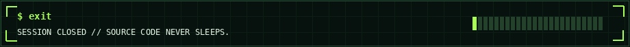

<!-- KENSHO / GitHub profile README — assets locales, sin servicios externos -->
<p align="center">
  
</p>

<p align="center">
  <a href="#01--whoami">IDENTIDAD</a> &nbsp;·&nbsp;
  <a href="#02--tech-stack">STACK</a> &nbsp;·&nbsp;
  <a href="#03--project-files">PROYECTOS</a> &nbsp;·&nbsp;
  <a href="#04--contact">CONTACTO</a>
</p>

## 01 / WHOAMI

```bash
$ whoami
> Alexander Sebastian Alcocer Flores

$ cat profile.conf
location    = Perú
education   = Diseño y Desarrollo de Software
focus       = Software Development / Linux / Automation
interests   = Web Development / Backend / Neural Networks
```

Soy desarrollador de software en formación. Trabajo con Python, aplicaciones web, bases de datos y entornos Linux. Me interesa construir herramientas que resuelvan problemas concretos, desde aplicaciones de uso cotidiano hasta proyectos de automatización e inteligencia artificial.

<p align="center">
  
</p>

## 02 / TECH STACK

```python
class Developer:
    def __init__(self):
        self.languages = ["Python", "PHP", "JavaScript", "SQL"]
        self.python = ["Scripting", "Automatización", "Programación"]
        self.linux = ["Kali Linux", "Debian", "CentOS"]
        self.web = ["React", "Laravel", "Node.js"]
        self.databases = ["MongoDB", "MySQL"]
        self.tools = ["Git", "Linux Terminal"]
```

| Directorio | Tecnologías |
| :--- | :--- |
| `~/languages` | **Python** · PHP · JavaScript · SQL |
| `~/linux` | Terminal Linux · Kali Linux · Debian · CentOS |
| `~/web` | React · Laravel · Node.js |
| `~/databases` | MongoDB · MySQL |
| `~/version-control` | Git |
| `~/research` | Redes neuronales — exploración y desarrollo con OASIS |

## 03 / PROJECT FILES

```text
~/projects/
├── edumap/         # Encuentra dónde estudiar con tus preferencias
├── dash/           # Reproductor de música
├── oasis/          # Bot completo con redes neuronales — en desarrollo
└── screenanswer/   # Porque más fácil no puede ser
```

<table>
<tr>
<td width="50%" valign="top">

<h3>01 — EDUMAP</h3>
<p><strong>Encuentra dónde estudiar con tus preferencias.</strong></p>
<p>Plataforma orientada a la búsqueda y comparación de instituciones educativas de acuerdo con las necesidades del estudiante.</p>
<code>EDTECH</code> · <code>DISCOVERY</code>
<!-- Agrega aquí el enlace real al repositorio o demo cuando esté disponible. -->
</td>
<td width="50%" valign="top">

<h3>02 — DASH</h3>
<p><strong>Reproductor de música.</strong></p>
<p>Proyecto propio enfocado en la reproducción musical y la experiencia de escuchar audio mediante una aplicación.</p>
<code>MULTIMEDIA</code> · <code>AUDIO</code>
<!-- Agrega aquí el enlace real al repositorio o demo cuando esté disponible. -->
</td>
</tr>
<tr>
<td width="50%" valign="top">

<h3>03 — OASIS</h3>
<p><strong>Bot completo en desarrollo.</strong></p>
<p>Proyecto de inteligencia artificial centrado en el desarrollo de un bot y la exploración de redes neuronales.</p>
<code>NEURAL NETWORKS</code> · <code>IN DEVELOPMENT</code>
<!-- Agrega aquí el enlace real al repositorio o demo cuando esté disponible. -->
</td>
<td width="50%" valign="top">

<h3>04 — SCREENANSWER</h3>
<p><strong>Porque más fácil no puede ser.</strong></p>
<p>Proyecto propio de software con una propuesta centrada en la simplicidad.</p>
<code>SOFTWARE</code> · <code>SIMPLICITY</code>
<!-- Agrega aquí el enlace real al repositorio o demo cuando esté disponible. -->
</td>
</tr>
</table>

<sub>Las animaciones son ilustraciones conceptuales de los proyectos, no capturas de sus interfaces reales.</sub>

## 04 / CONTACT

```text
[ CONNECTION AVAILABLE ]
> Desarrollo de software
> Colaboración en proyectos
> Intercambio de conocimientos
```

<p align="center">
  <a href="https://www.linkedin.com/in/alexander-sebastian-alcocer-flores-0aa703390/">LINKEDIN / PERFIL PROFESIONAL</a>
</p>

<p align="center">
  
</p>

<p align="center"><sub>KENSHO // BUILT WITH CODE · AREQUIPA, PERÚ</sub></p>
