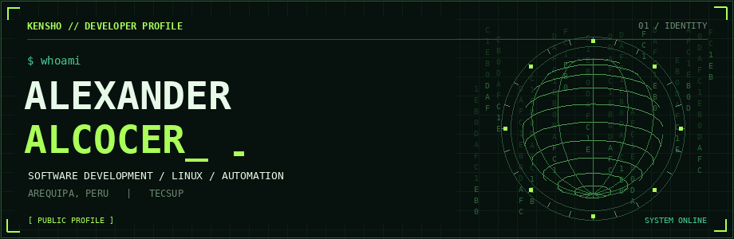
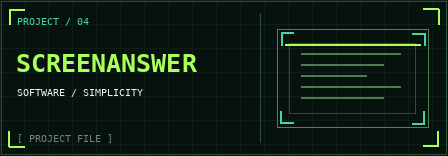

<!-- KENSHO // Perfil de desarrollador -->

<p align="center">
  
</p>

<p align="center">
  <code>SOFTWARE DEVELOPMENT</code> &nbsp;·&nbsp;
  <code>LINUX</code> &nbsp;·&nbsp;
  <code>AUTOMATION</code>
</p>

<p align="center">
  <a href="#01--perfil">PERFIL</a> &nbsp;·&nbsp;
  <a href="#02--stack">STACK</a> &nbsp;·&nbsp;
  <a href="#03--proyectos">PROYECTOS</a> &nbsp;·&nbsp;
  <a href="#04--contacto">CONTACTO</a>
</p>

---

## 01 // PERFIL

```text
┌─ kensho@github:~ ────────────────────────────┐
│ $ whoami                                     │
│ Alexander Sebastian Alcocer Flores          │
│                                              │
│ $ cat profile.conf                           │
│ ubicación  : Perú                            │
│ formación  : Diseño y Desarrollo de Software │
│ enfoque    : desarrollo · Linux · automatización │
│ intereses  : web · backend · redes neuronales│
└──────────────────────────────────────────────┘
```

Soy desarrollador de software en formación y me gusta convertir ideas en herramientas útiles. Exploro el desarrollo web, la programación, las bases de datos y los entornos Linux, con especial interés en la automatización y la inteligencia artificial.

<p align="center">
  
</p>

## 02 // STACK

| CAPA | TECNOLOGÍAS |
| :--- | :--- |
| `01 / LENGUAJES` | **Python** · PHP · JavaScript · SQL |
| `02 / WEB` | React · Laravel · Node.js |
| `03 / SISTEMAS` | Linux · Kali Linux · Debian · CentOS |
| `04 / DATOS` | MongoDB · MySQL |
| `05 / HERRAMIENTAS` | Git · terminal |
| `06 / EXPLORACIÓN` | Redes neuronales · inteligencia artificial |

## 03 // PROYECTOS

Proyectos personales en distintas etapas de desarrollo:

<table>
  <tr>
    <td width="50%" valign="top">
      <p align="center"></p>
      <h3>01 / EDUMAP</h3>
      <p><strong>Encuentra dónde estudiar con tus preferencias.</strong></p>
      <p>Plataforma para explorar y comparar instituciones educativas según las necesidades del estudiante.</p>
      <code>EDTECH</code> · <code>DISCOVERY</code>
    </td>
    <td width="50%" valign="top">
      <p align="center"></p>
      <h3>02 / DASH</h3>
      <p><strong>Un reproductor de música.</strong></p>
      <p>Aplicación propia enfocada en la reproducción musical y en una experiencia sencilla para escuchar audio.</p>
      <code>MULTIMEDIA</code> · <code>AUDIO</code>
    </td>
  </tr>
  <tr>
    <td width="50%" valign="top">
      <p align="center"></p>
      <h3>03 / OASIS</h3>
      <p><strong>Un bot en desarrollo.</strong></p>
      <p>Proyecto de inteligencia artificial para desarrollar un bot y explorar redes neuronales.</p>
      <code>IA</code> · <code>EN DESARROLLO</code>
    </td>
    <td width="50%" valign="top">
      <p align="center"></p>
      <h3>04 / SCREENANSWER</h3>
      <p><strong>Porque más fácil no puede ser.</strong></p>
      <p>Proyecto de software con una propuesta centrada en la simplicidad.</p>
      <code>SOFTWARE</code> · <code>SIMPLICIDAD</code>
    </td>
  </tr>
</table>

<p align="center"><sub>Las animaciones son ilustraciones conceptuales; no representan capturas de las aplicaciones.</sub></p>

## 04 // CONTACTO

¿Te interesa conversar sobre desarrollo de software, Linux o alguno de estos proyectos?

<p align="center">
  <a href="https://www.linkedin.com/in/alexander-sebastian-alcocer-flores-0aa703390/">
    <strong>↗ CONECTA CONMIGO EN LINKEDIN</strong>
  </a>
</p>

<p align="center">
  
</p>

<p align="center"><sub>KENSHO // CÓDIGO, CURIOSIDAD Y APRENDIZAJE CONTINUO</sub></p>
